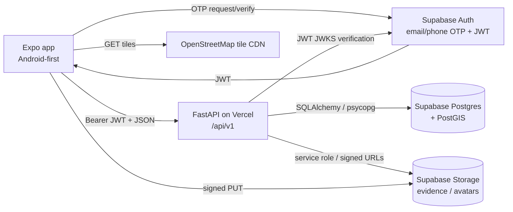
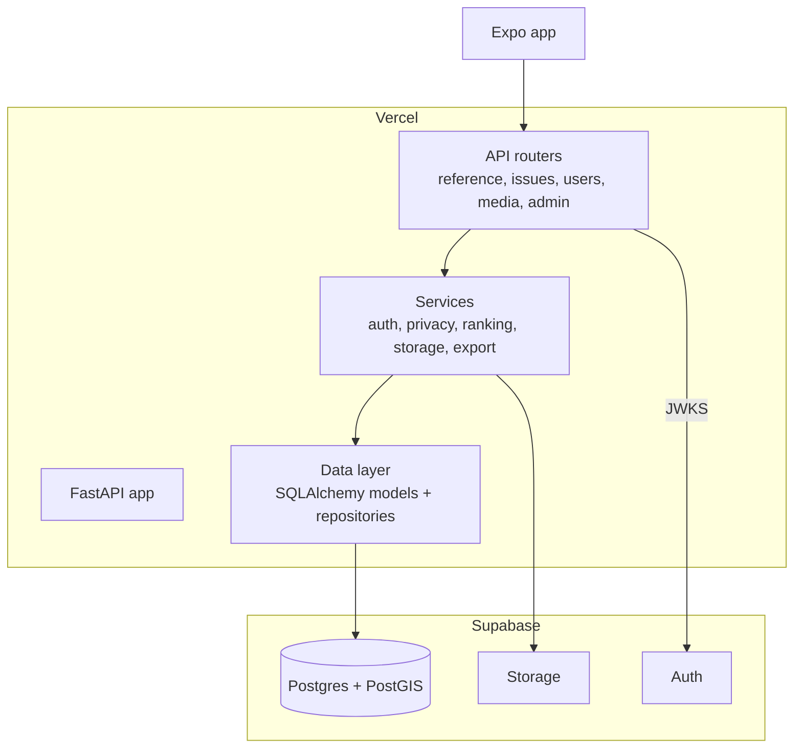
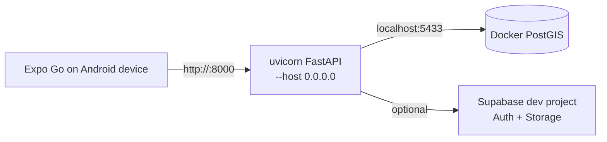

# Backend Architecture — Argus Panoptes

> Status: **proposed design**, not implemented. Verified platform facts are cited. The frontend is a local-state prototype; it must gain an API client, session persistence, GPS, and a real OTP screen as part of the cut-over.

## 1. Scope

Build a server-side system that can replace the frontend's mock data and simulated behaviours:

- Identity and profiles (Supabase Auth).
- Civic reports, voting, witnessing, comments, timeline.
- Reference data: categories/checkpoints, localities, wards, notices, service standards.
- Ward map assets and inspections.
- Media storage for evidence and avatars.
- User activity, favorites, impact metrics, exports.
- Administration of status changes and moderation.

Non-goals for the first backend release: DigiLocker OAuth, real municipal integrations (GHMC/HMWSSB/TSSPDCL), push notifications, RTI PDF generation, offline sync, and multi-language content translation. These remain frontend stubs or later phases.

## 2. System context



### Trust boundaries

- The Expo client is untrusted. It may claim coordinates, anonymity, or identity; the server derives identity from the JWT and decides masking.
- Supabase Auth is the identity provider. The FastAPI server verifies tokens against the project's JWKS; it does not issue tokens.
- Supabase Postgres and Storage are managed infrastructure. The server is the only write path for application data. Direct anonymous PostgREST writes are disabled.
- OSM tiles are third-party content; production use needs attribution and a usage-policy-compliant tile strategy.

## 3. Container/component view



### Proposed repository layout

```text
backend/
  pyproject.toml            # requires-python >=3.12; FastAPI, SQLAlchemy, Alembic, psycopg, PyJWT, GeoAlchemy2
  .python-version           # 3.13
  app/
    __init__.py
    main.py                 # FastAPI instance named `app` (Vercel entrypoint)
    core/
      config.py             # pydantic-settings
      security.py           # JWKS verification, current_user dependency
    db/
      base.py               # DeclarativeBase + naming conventions
      session.py            # engine + NullPool + session dependency
    models/                 # SQLAlchemy models grouped by domain
    schemas/                # Pydantic v2 request/response models (camelCase aliases)
    api/v1/
      reference.py
      issues.py
      comments.py
      users.py
      media.py
      notices.py
      wards.py
      admin.py
    services/
      ranking.py            # trending score
      privacy.py            # anonymous projections, coordinate masking
      storage.py            # signed upload/download URLs
      export.py             # GeoJSON / CSV / JSON
      refs.py               # public report reference generator
    seed/
      reference_data.py     # categories, checkpoints, localities, wards, notices, SLAs
  alembic/
    env.py
    versions/
  tests/
docker-compose.yml          # postgis/postgis:17-3.5 for local development
vercel.json                 # functions.maxDuration, optional rewrites
```

Keep the tree flat enough to navigate; do not add a repository abstraction per table. A small session dependency plus explicit queries is sufficient.

## 4. Runtime request flows

### 4.1 Sign-in (Supabase-managed)

1. Client calls Supabase Auth `otp` with email (Phase 1) or phone (Phase 2).
2. Client verifies the 6-digit OTP with Supabase Auth; receives access + refresh tokens.
3. Client stores the session securely (`expo-secure-store` adapter) and sends `Authorization: Bearer <access_token>` to FastAPI.
4. FastAPI verifies the JWT: signature via JWKS (`kid`), `iss`, `aud` (`authenticated`), `exp`, and `sub`.
5. FastAPI lazily creates/loads the `profiles` row for `sub`. A Supabase trigger may also create it; the lazy path keeps auth independent of migration timing.

FastAPI does **not** implement `/auth/request-otp` or `/auth/verify-otp`. Those are Supabase endpoints. The existing documentation's auth API is replaced.

### 4.2 Create report with photo

1. Client asks `POST /api/v1/media/upload-url` with `{purpose:"issue_evidence", contentType, contentLength}`.
2. Backend validates the user, MIME, and size, then returns a Supabase signed upload URL + object path (or a signed token).
3. Client compresses/strips EXIF locally, then PUTs the image directly to Supabase Storage. This avoids Vercel's **4.5 MB** request body limit.
4. Client calls `POST /api/v1/issues` with the object path, text fields, and optional coordinates.
5. Backend validates, resolves locality/ward (from the submitted locality or coordinates), applies coordinate masking if needed, stores the public geom, stores exact geom in a restricted table when available, seeds the `reported` event, and returns the created issue.
6. The backend returns short-lived signed download URLs for private evidence.

### 4.3 Vote / witness / comment

- All three are authenticated, idempotent toggles backed by unique constraints.
- Counters are updated in the same transaction with atomic SQL; the issue row is locked for vote/confirm updates or the counter is recomputed.
- A duplicate vote request returns the current state (idempotent), not a 500.
- Witnessing optionally validates that supplied coordinates are within a configurable radius of the report. The client must start sending coordinates for this to be enforceable.

### 4.4 Feed read

`GET /api/v1/issues` performs filtering, personalization (`userVote`, `userConfirmed`), pagination, and ranking in SQL. Trending is `vote_score*1.5 + comments_count*2`; the API exposes `upvotes = max(vote_score, 0)` to preserve the current UI.

## 5. Technology decisions (summary)

| Concern | Choice | Rationale |
|---|---|---|
| Language/framework | Python 3.12+ / FastAPI | User preference; ASGI-native on Vercel |
| ORM | SQLAlchemy 2.0 (sync) + psycopg 3 | Mature, type-friendly, simple; sync endpoints run in FastAPI's threadpool |
| Migrations | Alembic | Explicit, reviewable, Supabase-compatible |
| Validation | Pydantic v2 | Native to FastAPI; camelCase aliases for the Expo client |
| Spatial | PostgreSQL + PostGIS (`geography(Point,4326)`) | Distance in metres, GiST indexing, Supabase support |
| Auth | Supabase Auth (email OTP first, phone later) | Managed OTP/session/JWT; avoids building auth |
| Storage | Supabase Storage, direct signed uploads | Avoids Vercel body limits; managed CDN |
| Hosting | Vercel Functions (FastAPI single ASGI app) | User preference; verified support for Python 3.12–3.14 |
| Connection | Supavisor transaction pooler (6543) + SQLAlchemy `NullPool` | Serverless-safe; documented Supabase pattern |
| Local DB | Docker `postgis/postgis:17-3.5` | Matches Supabase PostGIS behaviour |

Detailed decisions: `docs/engineering/decisions/`.

## 6. Vercel compatibility (verified)

| Constraint | Verified value | Design response |
|---|---|---|
| FastAPI support | Vercel detects a `FastAPI` instance named `app` in `app.py`, `index.py`, `server.py`, `main.py`, `wsgi.py`, or `asgi.py` (root, `src/`, or `app/`) | Export `app` from `backend/app/main.py`; set `tool.vercel.entrypoint` if needed |
| Python versions | 3.12 (default), 3.13, 3.14 | Pin `.python-version` to 3.13 |
| Request/response body | 4.5 MB | Direct-to-storage uploads; never proxy image bytes through FastAPI |
| Function bundle | 500 MB standard (5 GB Large Functions beta) | Keep dependencies lean; no image-processing libs in the function |
| Duration | Hobby 300 s; Pro 800 s | All endpoints are short; background work uses Queues/Cron later |
| Memory | Hobby 2 GB; Pro 4 GB | Fine for API workloads |
| Filesystem | Read-only; `/tmp` ≤ 500 MB | No local uploads/exports; stream exports from memory/DB |
| Shutdown cleanup | ≤ 500 ms after SIGTERM | Do not rely on shutdown for critical work |
| Native system libs | Standard runtime does not document apt installs; use Container runtime for OS libraries | Use pure-Python/manylinux wheels; psycopg binary; no GDAL/GEOS in the API |
| Connection descriptors | 1,024 shared | Use Supavisor + `NullPool`; keep transactions short |

**Verdict:** the proposed FastAPI + Supabase architecture is compatible with Vercel, provided images bypass the function and the database uses the transaction pooler.

## 7. Supabase compatibility (verified)

- **PostGIS:** supported; enable with `create extension postgis with schema extensions;`. Prefer the `extensions` schema, not `public`.
- **Auth:** email OTP and phone OTP supported. SMS requires an external provider; India has TRAI DLT registration obligations. Default OTP expiry is 1 hour; default rate limit is one request per 60 seconds. OTP length should be set explicitly (6 digits) and matched in the UI; the current 4-digit UI is incompatible with SMS OTP's 6–10 digit range.
- **JWT:** asymmetric keys (ES256/RS256) are recommended; verify via `https://<project>.supabase.co/auth/v1/.well-known/jwks.json`. PyJWT + `PyJWKClient` is the proposed implementation.
- **Storage:** signed uploads and signed download URLs are supported; bucket-level size and MIME limits apply. Free project global limit is 50 MB per file (Pro/Team larger); set a bucket limit (e.g. 12 MB) and compress client-side.

## 8. Local development architecture



- `docker-compose.yml` runs PostGIS with a named volume and healthcheck.
- Alembic runs against the local database; the same migrations run against Supabase.
- Auth and Storage need a Supabase project even locally, unless a dev bypass is enabled. Any dev bypass must be environment-gated and must never exist in production.
- Local Python must be upgraded from 3.10.8 to 3.12/3.13 to match deployment.
- The initial client target is **Android-first via Expo Go**. Uvicorn binds to `0.0.0.0:8000`; the physical device reaches the PC through its LAN IP (`EXPO_PUBLIC_API_URL=http://<LAN-IP>:8000/api/v1`). The host firewall must allow the port and both devices must share the LAN.
- Native Android requests are not subject to browser CORS. CORS configuration is still required for Expo web/dev and any future browser client.
- HTTP is acceptable only on the local LAN. Production uses HTTPS (Vercel), and release builds must not allow cleartext traffic.
- The backend must remain platform-neutral (standard REST/JSON + Supabase JWT) so an iOS client can be added later without server changes.
- Expo Go covers the planned modules (camera, image picker, location, secure store, image manipulator, file system, sharing, SVG, Supabase JS). Remote push notifications require a development build.

## 9. Cross-cutting conventions

- API prefix `/api/v1`; camelCase JSON to match the Expo client.
- ISO-8601 UTC timestamps; optionally include display-friendly fields during the cut-over (`timeAgo`, timeline `date`).
- Pagination `page`/`limit` (default 20, max 100), response `{data, pagination:{total,page,totalPages}}`.
- Errors: `{error:{code,message,details}}` with appropriate HTTP status; 422 for Pydantic validation.
- Public identifiers: UUIDs for mutable entities; text slugs for reference data; human `public_ref` (`REP-RD-2026-XXXX`) for reports.
- Soft-delete comments/issues via `deleted_at`; never hard-delete evidence without a retention policy.
- All writes go through FastAPI. RLS is enabled as defense-in-depth, not as the primary authorization layer.

## 10. Frontend changes required for cut-over

The backend cannot make the current app live by itself. Required client work (Android-first via Expo Go):

1. Add `@supabase/supabase-js` + secure session storage (`expo-secure-store` adapter).
2. Replace `AuthContext` demo login with Supabase OTP; change OTP input to 6 digits.
3. Add an API client (`fetch` wrapper) with JWT, error handling, and retry/backoff. Read the base URL from `EXPO_PUBLIC_API_URL`; use the PC LAN IP in development and the Vercel HTTPS URL in production.
4. Add `expo-location`; capture coordinates at capture/create/confirm; show real GPS state.
5. Add `expo-image-manipulator` to compress and strip EXIF before signed upload.
6. Replace `IssuesContext` mock state with server queries and optimistic mutations.
7. Replace static localities/notices/categories/wards/assets with reference endpoints.
8. Fix GeoMap geography data (currently Bengaluru/Delhi/Mumbai) or scope the app to Hyderabad.
9. Implement a real export download (`expo-file-system` + `expo-sharing`).
10. Remove fake GPS, fake OTP, fake export, fake DigiLocker, and fake cache behaviours.
11. Validate the integrated app on a physical Android device through Expo Go against the locally running backend over LAN. Do not build APKs/AABs for routine iteration.
12. Include only public config in the app (`EXPO_PUBLIC_SUPABASE_URL`, anon/publishable key, `EXPO_PUBLIC_API_URL`). Never embed the service-role key or database credentials.
13. Use EAS Build/EAS Submit only for standalone testing and Play Store releases; use a development build only if a required native module is unavailable in Expo Go.

## 11. Verification status

- Platform claims above were checked against official Expo, Vercel, and Supabase documentation on 2026-11-08.
- No backend exists, so no runtime, migration, or test validation has been performed.
- Assumption: Supabase's managed Postgres and Storage behaviour matches its documentation in the target project tier. This must be confirmed against the actual project once MCP credentials are provided.
