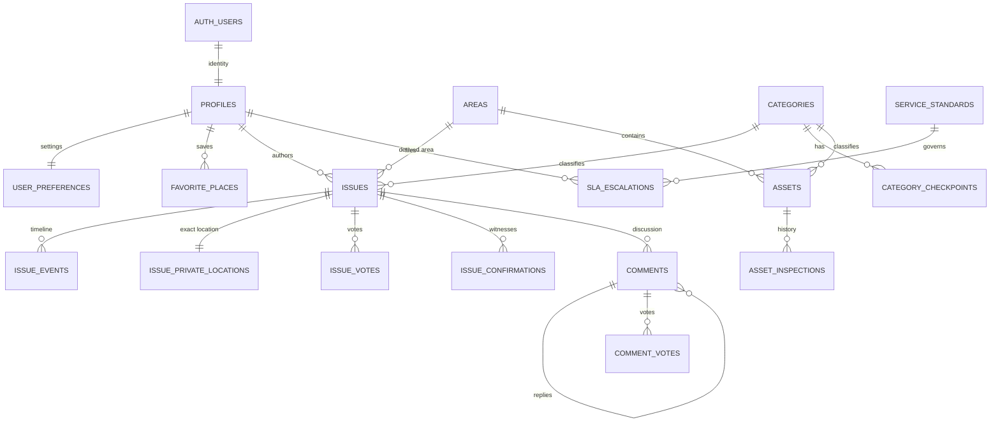

# Data Catalog — PostgreSQL + PostGIS

> Status: **partially implemented**. Migrations `a51d62769e7c` (reference tables), `207be3890891` (profiles, user_preferences), `d25fc97bcb78` (issues, private locations, events, votes, confirmations, comments, comment votes), `80f7f68cf6d8` (area zone/circle), `5975bdfe6c06` (favorite_places, sla_escalations), and `7a696ab4fc5d` (moderation columns, admin_audit_log) are applied locally. Assets, asset inspections, and ward-official/meeting tables remain proposed or deferred. Local target: `postgis/postgis:17-3.5`. Managed target: Supabase Postgres with PostGIS in the `extensions` schema.

## 1. Conventions

- Postgres 17 semantics; extensions installed in `extensions` (Supabase requirement).
- Mutable/user-generated entities: `uuid` PK, `gen_random_uuid()`.
- Reference data: stable text slugs (`roads`, `ward-98`, `banjara_hills`) for readable seeds and URLs.
- Status and enum-like fields: `text` + `CHECK`, not native enums (easier migrations).
- Timestamps: `timestamptz`, UTC, default `now()`.
- Spatial: `geography(Point,4326)` for metres; `geography(Polygon,4326)` for ward boundaries. GiST indexes.
- Counter columns are denormalized for feed performance and updated in the same transaction as the source row; a recompute script/endpoint will be provided.
- Soft delete only where the UI needs it; no cascade deletion of evidence.

## 2. Entity relationships

> **Geography note:** `AREAS` is the Hyderabad GHMC ward table imported from `ghmc_wards.kml` (sole source, ADR-010). It stores the ward name, GHMC zone/circle, and polygon. Ward officials/meetings are deferred until a separately verified municipal dataset is required.

## 3. Reference tables

### `areas`

Hyderabad (GHMC) wards imported from `ghmc_wards.kml`. `wards_hyderabad.geojson` is superseded (ADR-010).

| Column | Type | Constraints |
|---|---|---|
| `id` | uuid | PK |
| `name` | varchar(200) | not null, unique (`uq_areas_name`) |
| `zone` | varchar(100) | nullable; GHMC zone, falls back to circle |
| `circle` | varchar(100) | nullable; GHMC circle |
| `geom` | geometry(GEOMETRY,4326) | not null; Polygon or MultiPolygon |

GiST index `ix_areas_geom` on `geom`. Unique index on `name`. Migration `80f7f68cf6d8` adds `zone`/`circle`.

Import rules:

- Read `ghmc_wards.kml`; 155 Placemarks (148 Polygon, 7 MultiPolygon).
- Use the `ward` value as `name` (for example `121-KUKATPALLY`); `zone = ZONE` (fallback `CIRCLE`); `circle = CIRCLE`.
- Force 2D (`ST_Force2D`), set SRID 4326, repair with `ST_MakeValid`, upsert by `name`; delete unreferenced areas so the table matches the KML set.
- Do not store OSM metadata or other source properties in this table.
- Preserve the original KML. **Licence/attribution to be confirmed by the project owner**; do not label it ODbL/OSM.
- The verified source has 155 unique names, 0 empty names, 0 invalid geometries, and 25 boundary-sliver overlap pairs.

### Data quality notes

- Direct ward names include `121-KUKATPALLY`, `107-MADHAPUR`, `93-BANJARA HILLS`, `105-GACHIBOWLI`, and `68-TOLICHOWKI`.
- Secunderabad, HITEC City, and Dilsukhnagar are not direct ward names; they may be covered by adjacent wards. This is documented, not replaced with aliases.
- Overlaps are boundary slivers (largest 27,281 m², 0.56%/1.40% of the two wards); a point inside an overlap is reported `ambiguous`, never guessed.
- Full data-quality report: `docs/engineering/data-quality/ghmc_wards.md`.

### `categories`

| Column | Type | Constraints |
|---|---|---|
| `id` | text | PK (`health`, `ration`, `roads`, `transit`, `water`, `sanitation`, `power`, `drainage`) |
| `name` / `short_name` | varchar(100/50) | not null |
| `icon` / `color` / `bg_color` | varchar(50/20/20) | |
| `description` | text | |
| `status` / `status_label` | varchar(20/50) | |
| `compliance_score` | smallint | 0–100 |
| `active_assets_count` | integer | default 0 |
| `last_audited_at` | timestamptz | nullable |
| `avoided_cost_inr` | integer | nullable; used by impact metrics |
| `created_at` / `updated_at` | timestamptz | |

`compliance_score`, `active_assets_count`, and `last_audited_at` are derived from assets in later phases; seed values preserve the current UI.

### `category_checkpoints`

| Column | Type | Constraints |
|---|---|---|
| `id` | text | PK (`rd1`) |
| `category_id` | text | FK → categories(id) on delete cascade |
| `title` / `description` | varchar(150) / text | not null |
| `is_critical` | boolean | default false |
| `sort_order` | smallint | not null |

### `service_standards`

| Column | Type | Constraints |
|---|---|---|
| `id` | text | PK |
| `service` | varchar(150) | not null |
| `standard_hours` | integer | not null, > 0 |
| `authority` | varchar(150) | not null |
| `is_critical` | boolean | default false |
| `category_id` | text | FK → categories(id), nullable |

Seeds the Citizen Charter rows (pothole 48h, water burst 12h, streetlight 24h, waste 24h, manhole 6h, live power line 4h).

## 4. Identity tables

### `profiles`

| Column | Type | Constraints |
|---|---|---|
| `id` | uuid | PK, FK → `auth.users(id)` on delete cascade |
| `handle` | citext | unique, not null |
| `display_name` | varchar(150) | not null |
| `email` | citext | unique, nullable (mirrors auth) |
| `phone` | varchar(32) | unique, nullable |
| `role` | text | check in (`citizen`,`official`,`admin`), default `citizen` |
| `ward_id` | text | FK → wards(id), nullable |
| `address`, `area`, `city`, `state` | varchar | nullable |
| `pincode` | char(6) | check `~ '^[0-9]{6}$'` |
| `avatar_type` | text | check in (`preset`,`image`), default `preset` |
| `avatar_icon`, `avatar_icon_color`, `avatar_bg` | varchar | |
| `avatar_path` | text | Supabase Storage object path (not a public URL) |
| `banner_theme` | varchar(50) | default `civicGreen` |
| `score_percentage` | numeric(5,2) | default 100.00 |
| `digilocker_verified` | boolean | default false |
| `home_geom` | geography(Point,4326) | private anchor for masking; never public |
| `created_at` / `updated_at` | timestamptz | |
| `deleted_at` | timestamptz | nullable; set by `DELETE /users/me` (Phase 9) |

`audits_count` and `resolved_count` are **not stored**; compute them from issues or expose a stats endpoint/view. Add a covering index on `issues(author_id, status)`.

Implementation notes (Phase 2):

- `id` is the Supabase JWT `sub`. **No local FK to `auth.users`** is created, because that table exists only in Supabase and would break local/test databases.
- `handle` uses `varchar(50)` + unique (not `citext`); new profiles get `user_<first 12 hex of uuid>`. Handles are validated by the API as `^[a-z0-9_]+$`.
- `email` and `phone` mirror JWT claims at first sign-in; they are not client-editable.
- `home_geom` is **deferred to Phase 3** (location masking has no consumer yet).
- Profile and preferences rows are created lazily on the first authenticated request (`app/core/security.py`).
- **Phase 9:** `DELETE /users/me` anonymizes the profile (`handle=deleted_*`, contact fields cleared), sets `deleted_at`, removes favorites/escalations/votes/confirmations/preferences, and marks the user's issues/comments anonymous. Subsequent requests with the same token return 403. See `docs/engineering/privacy-retention.md`.
- **Phase 9:** migration `f127b8b90639` enables RLS (no policies) on all 17 application tables; FastAPI's owner/service role bypasses it, while Supabase `anon`/`authenticated` Data API roles get no access.

### `user_preferences`

| Column | Type | Constraints |
|---|---|---|
| `user_id` | uuid | PK, FK → profiles(id) on delete cascade |
| `pseudonymous_mode` | boolean | default true |
| `home_radius_masking` | boolean | default true |
| `gps_masking_radius_m` | smallint | check in (250,500,1000), default 500 |
| `show_contact_on_rti` | boolean | default false |
| `auto_sync_wifi` | boolean | default true |
| `notifications_enabled` | boolean | default true |
| `notification_channels` | jsonb | default `{"statusChanges":true,"upvotesAndComments":true,"wardAlerts":true,"emergencyBroadcasts":true}` |
| `theme_mode` | text | check in (`system`,`light`,`dark`) |
| `is_app_lock_enabled` | boolean | default false |
| `lock_timeout` | text | check in (`immediate`,`1m`,`5m`,`15m`) |
| `language` | text | check in (`en`,`hi`,`te`,`kn`,`ta`), default `en` |
| `auto_clear_cache` | boolean | default true |
| `created_at` / `updated_at` | timestamptz | |

The frontend currently stores the language label, not the code; the API should accept both during migration.

Implemented with defaults: `pseudonymous_mode=true`, `home_radius_masking=true`, `gps_masking_radius_m=500`, `show_contact_on_rti=false`, `auto_sync_wifi=true`, `notifications_enabled=true`, all four notification channels `true`, `theme_mode=system`, `is_app_lock_enabled=false`, `lock_timeout=5m`, `language=en`, `auto_clear_cache=true`. PUT and PATCH both apply only supplied fields.

### `favorite_places` — implemented (Phase 6)

| Column | Type | Constraints |
|---|---|---|
| `id` | uuid | PK |
| `user_id` | uuid | FK → profiles(id) on delete cascade |
| `area_id` | uuid | FK → areas(id) on delete set null, nullable |
| `label` | varchar(120) | not null |
| `geom` | geography(Point,4326) | nullable; optional saved point |
| `pinned` | boolean | default true |
| `created_at` | timestamptz | |

Unique `(user_id, area_id)` (`uq_favorite_places_user_area`); Postgres allows multiple point-only favorites because `area_id` is null. Index `(user_id, created_at)`. No localities table is created: ward search maps to `areas`. Issues count / last audited are computed, not stored.

## 5. Core report tables

### `issues`

| Column | Type | Constraints |
|---|---|---|
| `id` | uuid | PK |
| `public_ref` | varchar(40) | unique, not null (`REP-RD-2026-X81A`) |
| `category_id` | text | FK → categories(id), not null |
| `area_id` | uuid | FK → areas(id), **nullable**; derived by point-in-polygon |
| `area_assignment_status` | text | check in (`matched`,`unmatched`,`ambiguous`,`manual`), default `unmatched` |
| `area_assigned_at` | timestamptz | nullable |
| `author_id` | uuid | FK → profiles(id), not null (see anonymity decision) |
| `is_anonymous` | boolean | default false |
| `title` | varchar(100) | not null, check `char_length(btrim(title)) between 5 and 100` |
| `description` | varchar(500) | not null, check `char_length(btrim(description)) between 1 and 500` |
| `location_text` | varchar(255) | not null |
| `geom` | geography(Point,4326) | **not null** (public or masked) |
| `is_geom_masked` | boolean | default false |
| `image_path` | text | nullable (Storage object path) |
| `image_caption` | varchar(200) | nullable |
| `resolved_image_path` | text | nullable |
| `status` | text | check in (`reported`,`under_review`,`in_progress`,`resolved`), default `reported` |
| `priority` | text | check in (`standard`,`urgent`,`safety_hazard`), default `standard` |
| `is_urgent_hazard` | boolean | default false (server-computed from priority/regex) |
| `vote_score` | integer | default 0 |
| `confirmations_count` | integer | default 0, check >= 0 |
| `comments_count` | integer | default 0, check >= 0 |
| `created_at` / `updated_at` / `resolved_at` | timestamptz | |
| `hidden_at` | timestamptz | nullable; moderation hide (Phase 7) |
| `hidden_reason` | varchar(255) | nullable; moderator note |

Indexes:

- `(category_id, created_at desc)`
- `(status, created_at desc)`
- `(area_id, created_at desc)`
- `(area_assignment_status)`
- `(author_id, created_at desc)`
- GiST `(geom)`
- expression `((vote_score * 1.5 + comments_count * 2) desc, created_at desc)` for trending
- GIN on `to_tsvector('english', title || ' ' || description)` if text search is added

`upvotes` in API = `GREATEST(vote_score, 0)`. The author's initial upvote is a real `issue_votes` row.

Implementation notes (Phase 3):

- `author_id` is always stored (B-4 / ADR-007); `is_anonymous` controls the public projection. Public payloads return `author: "Anonymous Citizen"` and never `author_id`.
- The exact coordinate is written only to `issue_private_locations`. Public serializers never select it; the public `geom` is the submitted coordinate only until home-anchor masking exists.
- Area assignment: exactly one `ST_Covers` match → `matched`; multiple → `ambiguous`; none → `unmatched`. `area_id` is null for ambiguous/unmatched and no guess is made.
- **Acceptance envelope (Phase 9):** coordinates within `lat 17.27–17.60`, `lon 78.22–78.65` are accepted. A point inside the envelope but outside all 155 KML polygons is stored as `unmatched`; the API can report the nearest wards via `/areas/nearest` without assigning one. The KML's own bbox is `78.238974956,17.290716392,78.621714901,17.561001298`, so edge points north of 17.561 are unmatched.
- **Manual override (migration `b4f6a2c81d37`):** `POST /issues` accepts an optional `areaId`. When supplied, the issue is linked to that ward with `area_assignment_status='manual'`; the Hyderabad acceptance envelope is not enforced (the exact coordinates are still required and stored privately). This is user-chosen and is not an automatic derivation.
- Initial state on create: `status=reported`, `vote_score=1` plus an `issue_votes` row, and a `reported` event.
- `is_urgent_hazard` is derived from `priority='safety_hazard'`.
- Confirmation coordinates are required; `distance_m` is computed with geography `ST_Distance` and >2 km is rejected (422).
- Comment `depth` is server-enforced (reply to depth 3 → 422); `is_official` is derived from the author's role, never from the client.
- The trending expression index from the proposal was not created yet; filters/sorts use the listed B-tree and GiST indexes.
- `image_path` / `image_caption` are set only through `POST /issues/{id}/image` after ownership, existence, size (≤1 MiB), and content-type checks. Issue creation does not accept image fields. `resolved_image_path` remains for Phase 7.
- `avatar_path` is set only through `POST /users/me/avatar` with the same validation; `avatar_type` becomes `image`.
- Phase 7: `hidden_at`/`hidden_reason` are set only by admins. Hidden issues are excluded from every public/citizen query (feed, detail, comments, votes, confirms, evidence, activity, audits, impact, export) and appear only in `/admin/reports`. `resolved_image_path` is set only through `POST /issues/{id}/resolution-image` after the official-owned path, size, and MIME checks, and only when `status='resolved'`. Status advancement is forward-only and writes an `issue_events` row.

### `issue_private_locations`

| Column | Type | Constraints |
|---|---|---|
| `issue_id` | uuid | PK, FK → issues(id) on delete cascade |
| `exact_geom` | geography(Point,4326) | not null |
| `original_lat` / `original_lon` | numeric(9,6) / numeric(9,6) | |
| `created_at` | timestamptz | default now() |

Never selected by public serializers. No public API returns this table. Consider a separate database role with `SELECT` revoked for the API role if practical; otherwise enforce at the query layer and document it.

### `issue_events`

| Column | Type | Constraints |
|---|---|---|
| `id` | bigserial | PK |
| `issue_id` | uuid | FK → issues(id) on delete cascade |
| `status` | text | check in the four statuses |
| `description` | text | not null |
| `actor_id` | uuid | FK → profiles(id), nullable |
| `occurred_at` | timestamptz | default now() |

Index `(issue_id, occurred_at)`. The API builds the four-step timeline from these events plus the status order; completed = order <= current status order.

### `issue_votes`

| Column | Type | Constraints |
|---|---|---|
| `issue_id` | uuid | FK → issues(id) on delete cascade |
| `user_id` | uuid | FK → profiles(id) on delete cascade |
| `direction` | smallint | check in (-1, 1) |
| `created_at` | timestamptz | |
| PK | | `(issue_id, user_id)` |

### `issue_confirmations`

| Column | Type | Constraints |
|---|---|---|
| `issue_id` | uuid | FK → issues(id) on delete cascade |
| `user_id` | uuid | FK → profiles(id) on delete cascade |
| `confirmed_geom` | geography(Point,4326) | **not null** (the witness must supply coordinates) |
| `distance_m` | numeric | nullable, server-computed |
| `created_at` | timestamptz | |
| PK | | `(issue_id, user_id)` |

### `comments`

| Column | Type | Constraints |
|---|---|---|
| `id` | uuid | PK |
| `issue_id` | uuid | FK → issues(id) on delete cascade |
| `parent_id` | uuid | FK → comments(id) on delete cascade, nullable |
| `author_id` | uuid | FK → profiles(id), not null |
| `is_anonymous` | boolean | default false |
| `is_official` | boolean | default false |
| `body` | varchar(500) | not null, check length 1–500 |
| `depth` | smallint | check 0–3, default 0 |
| `vote_score` | integer | default 0 |
| `deleted_at` | timestamptz | nullable |
| `created_at` | timestamptz | |

Index `(issue_id, created_at)`. Depth is server-enforced; replying to a depth-3 comment returns 422. This fixes the current client bug.

### `comment_votes`

| Column | Type | Constraints |
|---|---|---|
| `comment_id` | uuid | FK → comments(id) on delete cascade |
| `user_id` | uuid | FK → profiles(id) on delete cascade |
| `direction` | smallint | check in (-1, 1) |
| `created_at` | timestamptz | |
| PK | | `(comment_id, user_id)` |

## 6. Notices and map assets

### `notices`

| Column | Type | Constraints |
|---|---|---|
| `id` | text | PK |
| `title` | varchar(200) | not null |
| `summary` | text | not null |
| `category` | text | check in (`water`,`roads`,`power`,`weather`,`infrastructure`) |
| `category_label` | varchar(100) | |
| `source` | varchar(150) | |
| `published_on` | date | not null |
| `expires_on` | date | nullable |
| `is_official` | boolean | default true |
| `impact` | text | |
| `contact_helpline` | varchar(50) | |
| `locality_text` | varchar(200) | nullable; display text |
| `created_at` / `updated_at` | timestamptz | |

Index `(expires_on)`, `(category)`. The API filters out notices where `expires_on < current_date` by default (`includeExpired=true` for admin). Notice-to-area linking is deferred until a notice-area mapping requirement is implemented.

### `assets` — deferred (B-3)

No verified Hyderabad asset dataset exists. `GeoMapScreen.js` contains 7 wards/16 assets for Bengaluru, Delhi, and Mumbai; these must not be seeded into a Hyderabad-only app. The schema below remains the plan for when a GHMC/audit data source is supplied. The table is not created by any current migration and has 0 rows.

Represents a monitored public infrastructure node (GeoMap's "audited problems").

| Column | Type | Constraints |
|---|---|---|
| `id` | text | PK (`ast-1`) |
| `area_id` | uuid | FK → areas(id), nullable; derived by point-in-polygon |
| `category_id` | text | FK → categories(id) |
| `title` | varchar(200) | not null |
| `problem_summary` | text | |
| `sector_label` | varchar(100) | display fallback if category differs |
| `severity` | text | check in (`Critical Defect`,`High Severity`,`Moderate`,`Compliant`) |
| `status` | text | check in (`Action Required`,`Needs Review`,`Verified`) |
| `address` | varchar(255) | |
| `geom` | geography(Point,4326) | nullable |
| `image_path` | text | nullable |
| `audited_by_text` | varchar(150) | nullable (current UI shows a name, not a user) |
| `last_audited_at` | timestamptz | nullable |
| `notes` | text | |
| `action_required` | text | |
| `sla_hours` | integer | nullable |
| `created_at` / `updated_at` | timestamptz | |

Indexes `(area_id)`, `(category_id)`, `(severity)`, `(status)`, GiST `(geom)`.

### `asset_inspections`

| Column | Type | Constraints |
|---|---|---|
| `id` | uuid | PK |
| `asset_id` | text | FK → assets(id) on delete cascade |
| `inspector_id` | uuid | FK → profiles(id), nullable |
| `audited_by_text` | varchar(150) | |
| `inspected_at` | timestamptz | not null |
| `severity` / `status` | text | same checks as assets |
| `notes` / `action_required` | text | |
| `image_path` | text | |
| `created_at` | timestamptz | |

## 7. Civic tools (later phase)

> Ward officials, ward meetings, and RSVP are **deferred**. The supplied GeoJSON provides only ward names and polygons; it does not provide officials, meeting schedules, or current administrative hierarchy. Do not invent that data. When a separately verified municipal source is required, introduce a municipal-unit table and link these entities to it.

### `ward_officials` (deferred)

`id`, `municipal_unit_id`, `role`, `name`, `phone`, `email`, `created_at`.

### `ward_meetings` (deferred)

`id`, `municipal_unit_id`, `title`, `scheduled_at`, `venue`, `agenda`, `minutes_url`, `created_at`.

### `ward_meeting_rsvps` (deferred)

`meeting_id`, `user_id`, `status` (`going`,`not_going`), `created_at`, PK `(meeting_id,user_id)`.

### `sla_escalations` — implemented (Phase 6)

| Column | Type | Constraints |
|---|---|---|
| `id` | uuid | PK |
| `user_id` | uuid | FK → profiles(id) on delete cascade |
| `issue_id` | uuid | FK → issues(id) on delete cascade, nullable |
| `service_standard_id` | varchar(50) | FK → service_standards(id), not null |
| `note` | text | nullable |
| `status` | varchar(20) | check in (`queued`,`acknowledged`,`closed`), default `queued` |
| `created_at` | timestamptz | |

Unique `(user_id, issue_id, service_standard_id)`; duplicate escalation returns 409. Index `(user_id, created_at)`. No status-transition endpoint yet (Phase 7).

### `admin_audit_log` — implemented (Phase 7)

Append-only record of privileged actions. Officially named "admin" but also records official status changes and moderation views.

| Column | Type | Constraints |
|---|---|---|
| `id` | bigserial | PK |
| `actor_id` | uuid | FK → profiles(id) on delete set null, nullable |
| `action` | varchar(50) | not null (`issue.status`, `issue.hide`, `issue.unhide`, `issue.resolution_image`, `comment.hide`, `comment.unhide`, `moderation.view`, `notice.create`, `notice.update`, `notice.delete`, `user.role`) |
| `entity_type` | varchar(30) | not null (`issue`, `comment`, `notice`, `profile`, `admin_reports`) |
| `entity_id` | varchar(64) | not null; UUID or notice slug |
| `details` | jsonb | not null, default `{}` |
| `created_at` | timestamptz | not null, default now() |

Indexes `(created_at)`, `(actor_id)`. Read via `GET /admin/audit-log` (admin, newest first). No update/delete path.

### `rti_applications`

Deferred until a real RTI generator is requested: `id`, `user_id`, `issue_id` nullable, `body`, `pio_contact`, `status`, `submitted_at`, `created_at`. The current UI only shows an alert; do not build this yet.

### `push_tokens` and `notifications`

Deferred. No push implementation exists in the client.

## 8. Seed data (initial migration)

| Table | Rows |
|---|---|
| `areas` | 155 GHMC wards imported from `ghmc_wards.kml` |
| `categories` | 8 |
| `category_checkpoints` | 32 |
| `notices` | 5 (with `locality_text`) |
| `service_standards` | 6 |
| `assets` | Not created yet (B-3 deferred); the in-repo GeoMap data is Bengaluru/Delhi/Mumbai and must not be seeded |

Seed scripts must be idempotent (`INSERT ... ON CONFLICT DO UPDATE`) so they can run in local, preview, and production environments.

## 8.1 `wards_hyderabad.geojson` import (Phase 1.5) — **superseded by ADR-010**

> Historical section. The active import is `ghmc_wards.kml` (155 wards); see §3 and `data-quality/ghmc_wards.md`.

Verified facts and constraints:

1. The file is a `FeatureCollection` with **145 features** (140 Polygon, 5 MultiPolygon), no `crs` member (GeoJSON WGS84), bbox `78.2717512, 17.2916377, 78.6212303, 17.5608321`.
2. `Name` is unique across all 145 features; 0 empty names; 0 invalid source geometries; 0 overlapping ward pairs.
3. Coordinates include `z = 0.0`; force to 2D before inserting into a 2D geometry column.
4. Import only `name` and `geom` into `areas`. Do not store OSM metadata (`_id`, `_timestamp`, `_user`, `_changeset`, `_version`, etc.).
5. Upsert by `name`; apply `ST_Force2D`, `ST_SetSRID(...,4326)`, and `ST_MakeValid`.
6. Preserve the original file and attribution: OSM-derived, ODbL 1.0, `© OpenStreetMap contributors`.
7. Report: feature count, unique names, empty/duplicate names, invalid geometries, bbox, recognizable-name coverage, and sample point-in-polygon results.
8. Never guess an area for a point outside all polygons or inside multiple conflicting polygons.
9. Do not introduce an alternative dataset unless a coverage/accuracy issue is identified and documented.

## 9. Migration and integrity rules

1. Enable `postgis` in `extensions` before spatial migrations.
2. Use Alembic with a naming convention (`pk_`, `fk_`, `uq_`, `ck_`, `ix_`).
3. Create reference tables before dependent tables; seed after schema creation.
4. Counter updates and vote/confirmation inserts occur in one transaction.
5. Unique constraints enforce one vote/one confirmation per user per target.
6. Add `updated_at` triggers only where the ORM does not set it; keep it simple.
7. Run `alembic upgrade head` against a scratch Supabase branch before production.
8. Never run migrations automatically on Vercel function cold start.
