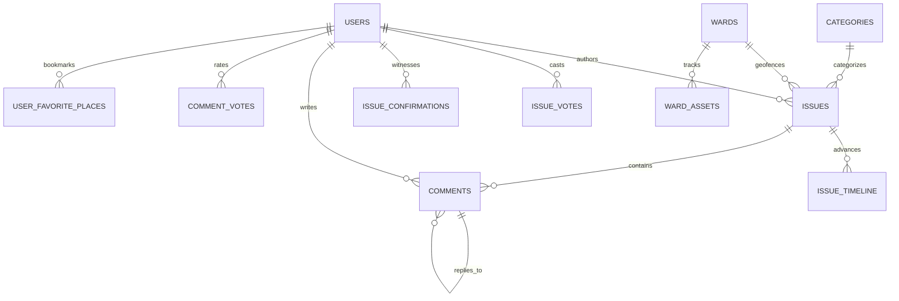

# Argus Panoptes — Complete Technical Documentation for Backend Development

> **Platform**: React Native / Expo (`frontend/`)  
> **Domain**: Civic Intelligence, Municipal Infrastructure Auditing & Citizen Ground Truth Verification  
> **Geographic Scope**: Greater Hyderabad Municipal Corporation (GHMC) & Scalable Pan-India Municipal Jurisdictions  
> **Purpose**: Primary technical reference manual for backend developers to implement server-side APIs, database schemas, authentication workflows, storage layers, and civic intelligence processing without investigating the frontend codebase.

---

## Table of Contents
1. [Executive Summary & System Architecture](#1-executive-summary--system-architecture)
2. [Technology Stack & Dependencies](#2-technology-stack--dependencies)
3. [Folder & File Structure](#3-folder--file-structure)
4. [Frontend Architecture & State Management](#4-frontend-architecture--state-management)
5. [Feature-by-Feature Technical Breakdown](#5-feature-by-feature-technical-breakdown)
6. [Backend API Specifications](#6-backend-api-specifications)
7. [Database Schema & Entity-Relationship Modeling (PostgreSQL + PostGIS)](#7-database-schema--entity-relationship-modeling-postgresql--postgis)
8. [Business Logic, Validations & Algorithmic Rules](#8-business-logic-validations--algorithmic-rules)
9. [Media Storage, Exif Processing & Security](#9-media-storage-exif-processing--security)
10. [Open Data Export Formats](#10-open-data-export-formats)
11. [Backend Developer Integration & Implementation Checklist](#11-backend-developer-integration--implementation-checklist)
12. [Existing Code vs. Required Backend vs. Assumptions Matrix](#12-existing-code-vs-required-backend-vs-assumptions-matrix)

---

## 1. Executive Summary & System Architecture

**Argus Panoptes** is a decentralized, geotagged civic intelligence auditing platform designed to document, verify, monitor, and resolve public infrastructure defects. It connects citizen reports directly to public works departments (e.g., GHMC Khairatabad Circle, HMWSSB Water Supply Wing, TSSPDCL Metro Electricity Discom, TSRTC Transit Authority).

### Core Pillars
1. **Photographic Ground Truth**: Direct on-device camera engine for real-time visual inspection with geospatial tagging (`src/screens/HomeScreen.js`).
2. **Community Ground Confirmation ("Witnessed on site")**: Independent physical bystander confirmations that establish evidentiary weight, prevent spam, and trigger priority municipal intervention (`src/components/home/CommunityConfirmationControl.js`).
3. **Pseudonymous Whistleblower Protection**: Zero-knowledge reporting modes and configurable home coordinate fuzzing (GPS masking at 250m, 500m, or 1000m) to shield citizen identities (`src/screens/SettingsScreen.js`).
4. **Editorial Civic Minimalist Aesthetic**: Strict architectural visual language adhering to high-contrast neutrals (`#FFFFFF`, `#F8FAFC`, `#0F172A`, `#E2E8F0`), high-contrast typography, and zero pastel "AI-slop" badge styling (`AGENTS.md` and `ui-design-rules.md`).

---

## 2. Technology Stack & Dependencies

### Frontend Implementation
- **Core Framework**: React Native `0.88.1` / React `19.3.0`
- **Application Toolchain**: Expo SDK `^58.0.0`
- **Native Hardware Modules**:
  - `expo-camera` (`~58.0.14`): Controls camera sensor, flash/torch, zoom, and orientation.
  - `expo-image-picker` (`~58.0.10`): Device photo gallery access and image capture fallback.
- **Vector Icons & UI**: `@expo/vector-icons` (`^15.0.2` - Feather, Ionicons), `react-native-svg` (`15.16.0`).
- **Web Runtime**: `react-native-web` (`^0.21.4`), `react-dom` (`19.3.0`).

### Target Backend Technology Recommendations
- **Application Server**: Node.js (TypeScript) / Go / Python (FastAPI).
- **Database Engine**: **PostgreSQL `>=15` with `PostGIS` extension** (required for spatial point queries, distance calculations, coordinate fuzzing, and bounding boxes).
- **Storage Layer**: AWS S3 / Cloudflare R2 / MinIO for photo evidence and before/after verification images.
- **Cache & Real-time Layer**: Redis for session cache, live vote/confirmation counters, and geospatial caching.

---

## 3. Folder & File Structure

```text
argus_panoptes/
├── package.json                              # Root orchestrator scripts
├── AGENTS.md                                 # Protected camera guidelines & badge styling rules
├── CONTEXT.md                                # Comprehensive application architecture guide
├── documentation.md                          # Primary backend engineering specification
├── .agents/rules/ui-design-rules.md          # Anti "AI-slop" styling rules
└── frontend/                                 # React Native / Expo application
    ├── App.js                                # Root application entry, navigation state & providers
    ├── app.json                              # Expo configuration manifest
    ├── package.json                          # Frontend dependencies
    └── src/
        ├── assets/categories/                # 8 Sector cover photographs
        ├── components/
        │   ├── community/                    # Community feed components
        │   │   ├── CommentItem.js            # Threaded recursive comment item
        │   │   ├── CommentSection.js         # Threaded discussion section & input
        │   │   ├── IssueCard.js              # Community feed card
        │   │   └── VoteControl.js            # Upvote/downvote counter
        │   ├── home/                         # Dashboard & camera screen modules
        │   │   ├── CommunityConfirmationControl.js # Ground truth witness buttons
        │   │   ├── LocalityPickerModal.js    # Ward/locality search & selector modal
        │   │   ├── LocationHeader.js         # Top header with ward capsule & notification bell
        │   │   ├── MunicipalNoticeCard.js    # Official bulletin card
        │   │   ├── MunicipalNoticeSection.js # Notice feed
        │   │   ├── NearbyIssueCard.js        # Nearby issue card
        │   │   ├── NearbyIssuesSection.js    # Section of nearby issues
        │   │   ├── NoticesNotificationModal.js # Municipal notices & circulars modal
        │   │   ├── PersonalCivicActivityModal.js # Personal civic footprint (4 filter tabs)
        │   │   ├── WardAtAGlance.js          # 4-metric ward summary
        │   │   ├── WardNeedsAttention.js     # Unresolved prioritized issues
        │   │   └── WardRecentlyResolved.js   # Resolved issues with before/after photos
        │   ├── modals/
        │   │   ├── AuthModal.js              # OTP authentication & citizen registration modal
        │   │   └── MediaModal.js             # Profile photo & avatar customization modal
        │   ├── navigation/
        │   │   └── CurvedBottomBar.js        # Curved bottom navigation tab bar
        │   └── profile/
        │       ├── CivicSaluteBannerSvg.js   # Profile header vector illustrations
        │       ├── ProfileBanner.js          # Customizable profile cover banner
        │       ├── ProfileHeader.js          # Avatar, handle, name & DigiLocker badge
        │       └── ProfileMenuList.js        # Profile navigation list
        ├── constants/
        │   ├── categoriesData.js             # 8 administrative sectors, SLAs & checkpoints
        │   ├── categoryImages.js             # Sector image asset mappings
        │   ├── colors.js                     # Brand color palette tokens
        │   ├── localities.js                 # GHMC zones, circles, wards, and landmarks
        │   ├── mockIssues.js                 # Comprehensive initial issues dataset
        │   ├── municipalNotices.js           # Official circulars dataset
        │   ├── presets.js                    # Demo accounts & seed profiles
        │   └── tabs.js                       # Navigation tab identifiers
        ├── context/
        │   ├── AuthContext.js                # Identity, authentication, and security state
        │   └── IssuesContext.js              # Civic issues CRUD, voting, confirmation, comments
        └── screens/
            ├── CategoriesScreen.js           # 8-Sector photographic grid overview
            ├── CategoryFeedScreen.js         # Sector community feed with sorting & rubric modal
            ├── CreateIssueScreen.js          # Issue reporting form with photo attachment
            ├── EditProfileScreen.js          # Citizen contact & address editor
            ├── GeoMapScreen.js               # Interactive OSM slippy map & ward asset inspector
            ├── GuestProfileScreen.js         # Unauthenticated landing & login prompt
            ├── HomeScreen.js                 # Camera inspection engine & ward command center
            ├── IssueDetailScreen.js          # Full issue dossier, timeline & discussion
            ├── ProfileScreen.js              # Citizen profile, KPIs, and menu hub
            ├── ProfileSubPages.js            # My Audits, Impact, Favorite Places, RTI, SLAs, Ward Docket
            └── SettingsScreen.js             # Privacy, GPS fuzzing, biometrics, export, cache
```

---

## 4. Frontend Architecture & State Management

Navigation is managed via `CurvedBottomBar.js` with 4 primary tabs:
- **`home`**: `HomeScreen.js` (Live camera inspection engine + Ward command center).
- **`categories`**: `CategoriesScreen.js` $\rightarrow$ `CategoryFeedScreen.js` (Sector community feeds).
- **`map`**: `GeoMapScreen.js` (OpenStreetMap tile renderer + ward asset inspector).
- **`profile`**: `ProfileScreen.js` / `GuestProfileScreen.js` (Citizen profile, subpages, settings).

### Global Context Providers in `App.js`
- **`AuthContext`** (`src/context/AuthContext.js`):
  - State: `isLoggedIn`, `user`, `pseudonymousMode`, `homeRadiusMasking`, `notificationsEnabled`, `themeMode`, `isAppLockEnabled`, `language`.
  - Methods: `loginWithDemo(account)`, `registerUser(name, ward, contact)`, `updateUserProfile(fields)`, `updateAvatarUrl(url)`, `signOut()`.
- **`IssuesContext`** (`src/context/IssuesContext.js`):
  - State: `issues` (initialized with `MOCK_ISSUES` from `src/constants/mockIssues.js`).
  - Methods: `addIssue(issueData)`, `voteIssue(id, direction)`, `confirmIssue(id)`, `addComment(issueId, text, parentId, authorInfo)`, `voteComment(issueId, commentId, direction)`, `getIssuesByCategory(categoryId, sortBy)`, `getIssueById(id)`.

---

## 5. Feature-by-Feature Technical Breakdown

### 5.1 Tab 1: Home Command Center (`HomeScreen.js`)
- **Locality Selection**:
  - `LocationHeader`: Capsule pill displaying active ward (e.g. `Bahadurpally · Ward 129 ▾`). Contains personal civic activity button (fingerprint icon) and municipal notices button (bell icon).
  - `LocalityPickerModal`: Live search across 9 GHMC municipal zones, 150+ wards, circles, and landmarks from `src/constants/localities.js`. Provides one-tap GPS auto-detection (`Bahadurpally · Ward 129`).
- **Protected Camera Engine (`HomeScreen.js`)**:
  - Viewfinder modes: Compressed (200px) and Expanded (580px / 72% screen height).
  - Controls: Camera sensor flip (front/back), Torch toggle, Zoom toggle (1x / 2x / 0.25 steps), gallery fallback picker, pinch-to-zoom pan responder.
  - Post-Capture Workflow: Displays full-frame evidence photo with green GPS fix pill. Citizen taps "Report Civic Issue" to launch `CreateIssueScreen.js` with preloaded photo and location, or "Retake Photo".
- **Contextual Municipal Advisories**: Renders active notices matching the active ward from `src/constants/municipalNotices.js`.
- **Ward Intelligence Dashboard**:
  - `WardAtAGlance`: Computes 4 KPIs:
    1. Active Issues (`status !== 'resolved'`).
    2. Urgent Hazards (`priority === 'hazard'` or keywords: `hazard`, `danger`, `crater`, `emergency`, `collapse`, `live`, `exposed`, `sagging`).
    3. Awaiting Verification (`status === 'reported'` or `confirmationsCount < 10`).
    4. Resolved This Week (`status === 'resolved'`).
  - `WardNeedsAttention`: Top 3 unresolved defects, prioritizing urgent hazards first, followed by oldest report creation date (`createdAt ASC`).
  - `WardRecentlyResolved`: Resolved defects with interactive Before/After photo comparison toggle.
- **Personal Civic Activity Modal**: Shows 4 filter tabs:
  - `Submitted`: Issues authored by citizen.
  - `Witnessed`: Issues where citizen confirmed physical ground presence.
  - `Resolved`: Tracked issues that reached completed resolution.
  - `Tracked`: Issues upvoted or bookmarked.

### 5.2 Tab 2: Geospatial Ward Map (`GeoMapScreen.js`)
- **OpenStreetMap Slippy Tile Engine**:
  - Uses standard Web Mercator math (`lon2tile`, `lat2tile`) across zoom levels 3.5 to 18.5.
  - Fetches tiles from `https://tile.openstreetmap.org/{z}/{x}/{y}.png`.
  - Multi-touch pinch-to-zoom and pan gesture handlers with `flyTo` coordinate transitions.
- **Filtering Suite (Amazon-Style Filter Sheet)**:
  - Ward-level filters: Sort by distance, open flags count, health compliance score, audit coverage %, or alphabetical name. Filter by risk levels (`critical`, `moderate`, `clear`), distance radii (`2km`, `5km`, `10km`, `any`), zones (`East Zone`, `South Zone`, `Mahadevapura`, etc.), and sectors.
  - Asset-level filters: Sort by urgency, recent date, or category. Filter by sectors, severity levels (`Critical Defect`, `High Severity`, `Moderate`, `Compliant`), and status (`Action Required`, `Needs Review`, `Verified`).
- **Asset Detail Modal**: Full public asset dossier showing audited department, engineer attribution, last audit timestamp, field notes, required action, and statutory SLA.

### 5.3 Tab 3: Municipal Sectors & Feeds (`CategoriesScreen.js` & `CategoryFeedScreen.js`)
- **8 Core Civic Sectors** (from `src/constants/categoriesData.js`):
  1. `health`: Healthcare & Clinics (PHCs, Anganwadis, medicine stock, cold-chain vaccines).
  2. `ration`: PDS & Food Security (Fair price shops, weigh scale calibration seals, biometric e-POS).
  3. `roads`: Roads & Works (Potholes, pedestrian walkways, streetlights, zebra crossings).
  4. `transit`: Public Transit & Stops (Bus shelters, tactile paving, schedules, emergency lighting).
  5. `water`: Water Works & Supply (Pipeline leaks, chlorine potability, water ATMs, tankers).
  6. `sanitation`: Sanitation & Waste (Garbage blackspots, source segregation, e-toilets, compactors).
  7. `power`: Power Grid & Electrical (Ground transformers, cable sag clearance, feeder pillars, earthing).
  8. `drainage`: Storm Drainage (Manhole grates, desilting, culverts, outfall flap gates).
- **Official Inspection Rubric Modal**: Displays protocol checkpoints per sector with critical hazard indicators and citizen checklists.
- **Community Feed**:
  - Sorting tabs: `trending` ($1.5 \times \text{upvotes} + 2 \times \text{comments}$), `new` (chronological), `top` (raw upvotes).
  - Floating Action Button (`+`) to file a report.

### 5.4 Subscreens: Issue Lifecycle (`CreateIssueScreen.js` & `IssueDetailScreen.js`)
- **Reporting Engine**:
  - Validation: Title (5-100 characters), Description (1-500 characters), Location/Area (required).
  - Evidence attachment: Photographic capture or gallery selection.
  - Anonymous toggle: Replaces user name/handle with "Anonymous Citizen" and hides profile link.
- **Issue Dossier**:
  - Full photographic evidence display with optional caption.
  - Location badge and author credibility tier.
  - 4-stage resolution timeline: `Reported` $\rightarrow$ `Under Review` $\rightarrow$ `In Progress` $\rightarrow$ `Resolved`. Each stage includes date, administrative division attribution, and status flag.
  - Interactive voting and community confirmation.
  - Recursive threaded comments with reply targeting and comment upvoting.

### 5.5 Tab 4: Profile, Legal Toolkit & Settings (`ProfileScreen.js` & `SettingsScreen.js`)
- **Citizen Profile**: Cover banner theme, profile avatar (preset or custom URL), handle, name, ward, phone, email, and DigiLocker verification badge.
- **My Audits Subpage**: KPI ribbon (Total, Verified, In Review), personal audit list with generated report IDs (`REP-xxx-2026`) and accuracy scores.
- **My Civic Impact Subpage**: Financial waste prevented algorithm (e.g. ₹1,02,400 saved), accuracy rating, and sector-by-sector savings breakdown.
- **Favorite Places Subpage**: Pinned monitored hotspots with active issue counts and notification alerts.
- **RTI & Civic Legal Toolkit**: Automated drafting under Section 6(1) of the RTI Act 2005, Section 4(1)(b) proactive disclosure logs, and 30-day statutory response clock tracking.
- **Citizen Charter & SLAs**: Statutory maximum repair timelines (e.g., 6h for missing manholes, 4h for live power lines, 48h for potholes) and escalation notice filing.
- **Ward Committee Docket**: Directory of Ward Corporator, Executive Engineer, Sanitary Inspector, and Water Manager, with Area Sabha meeting schedules and RSVP.
- **Settings Screen**:
  - *Privacy & Security*: Anonymous auditing toggle, GPS geofence masking radius (250m, 500m, 1000m), biometric app lock timeout (`immediate`, `1m`, `5m`, `15m`).
  - *Preferences*: Theme mode (`system`, `light`, `dark`), notification channels (status changes, comments/upvotes, ward maintenance bulletins, emergency broadcasts), Wi-Fi only sync, interface language (English, Hindi, Telugu, Kannada, Tamil).
  - *Data & Trust*: DigiLocker e-KYC credential verification refresh, data export (GeoJSON spatial archive, CSV spreadsheet, raw JSON), device storage/cache clearing.

---

## 6. Backend API Specifications

All endpoints expect `Content-Type: application/json` unless handling `multipart/form-data`. All authenticated requests must supply `Authorization: Bearer <jwt_token>`.

### 6.1 Authentication & Profile Endpoints

#### 1. `POST /api/v1/auth/request-otp`
- **Purpose**: Initiates phone or email verification.
- **Request Body**:
  ```json
  {
    "identifier": "+919876543210"
  }
  ```
- **Validation**: Required string; valid E.164 phone or valid email format.
- **Response `200 OK`**:
  ```json
  { "success": true, "message": "OTP dispatched", "expiresIn": 300 }
  ```

#### 2. `POST /api/v1/auth/verify-otp`
- **Purpose**: Validates 4-digit code and logs in / registers the citizen.
- **Request Body**:
  ```json
  {
    "identifier": "+919876543210",
    "otp": "1234",
    "registrationData": {
      "name": "Champ Thanachoat",
      "ward": "Ward 112 • Indiranagar, East Zone",
      "email": "champ.civic@gmail.com",
      "phone": "+919876543210"
    }
  }
  ```
- **Response `200 OK`**:
  ```json
  {
    "token": "eyJhbGciOiJIUzI1NiIsInR5cCI6IkpXVCJ9...",
    "user": {
      "id": "usr-4081",
      "name": "Champ Thanachoat",
      "handle": "Citizen Scout #4081",
      "ward": "Ward 112 • Indiranagar, East Zone",
      "email": "champ.civic@gmail.com",
      "phone": "+919876543210",
      "avatarType": "preset",
      "avatarIcon": "user",
      "avatarIconColor": "#2A3036",
      "avatarBg": "#EDEFF0",
      "avatarUri": "",
      "bannerTheme": "civicGreen",
      "auditsCount": 42,
      "resolvedCount": 18,
      "score": "98.4%",
      "digiLockerVerified": true
    }
  }
  ```

#### 3. `GET /api/v1/users/me`
- **Purpose**: Fetches the authenticated user profile and security preferences.
- **Response `200 OK`**: Complete user object matching preset schema.

#### 4. `PUT /api/v1/users/me`
- **Purpose**: Updates profile details from `EditProfileScreen.js`.
- **Request Body**:
  ```json
  {
    "name": "Champ Thanachoat",
    "email": "champ.civic@gmail.com",
    "phone": "+91 98765 43210",
    "address": "#42, 12th Main Road, HAL 2nd Stage",
    "area": "Indiranagar, Ward 112",
    "city": "Bengaluru",
    "state": "Karnataka",
    "pincode": "560038",
    "ward": "Indiranagar, Ward 112, Bengaluru",
    "avatarType": "image",
    "avatarUri": "https://storage.argus.org/avatars/usr-4081.jpg",
    "bannerTheme": "slateNavy"
  }
  ```
- **Validation**:
  - `name`: Required, non-empty string.
  - `pincode`: Optional 6-digit numeric string.
  - `handle`: Read-only, cryptographic identifier.

#### 5. `PUT /api/v1/users/me/preferences`
- **Purpose**: Persists preferences from `SettingsScreen.js`.
- **Request Body**:
  ```json
  {
    "pseudonymousMode": true,
    "homeRadiusMasking": true,
    "gpsMaskingRadius": "500m",
    "autoSyncWifi": true,
    "notificationsEnabled": true,
    "themeMode": "system",
    "isAppLockEnabled": false,
    "lockTimeout": "immediate",
    "language": "English",
    "notificationChannels": {
      "statusChanges": true,
      "upvotesAndComments": true,
      "wardAlerts": true,
      "emergencyBroadcasts": true
    }
  }
  ```

---

### 6.2 Civic Issues & Reporting Endpoints

#### 1. `GET /api/v1/issues`
- **Purpose**: Main issue feed supporting locality filtering, category feeds, and sorting.
- **Query Parameters**:
  - `localityId` (string, optional): e.g. `banjara_hills`, `bahadurpally`.
  - `ward` (string, optional): e.g. `Ward 98`.
  - `categoryId` (string, optional): One of the 8 sectors (`health`, `ration`, `roads`, `transit`, `water`, `sanitation`, `power`, `drainage`).
  - `sortBy` (string, optional): `trending`, `new`, `top`, `resolved`.
  - `status` (string, optional): `reported`, `under_review`, `in_progress`, `resolved`.
  - `page` (int, default 1), `limit` (int, default 20).
- **Response `200 OK`**:
  ```json
  {
    "data": [
      {
        "id": "issue-rd-1",
        "categoryId": "roads",
        "title": "Dangerous pothole near the main junction",
        "description": "Deep unbarricaded crater (~75mm depth)...",
        "location": "Banjara Hills, Road No. 12 Junction",
        "localityId": "banjara_hills",
        "ward": "Ward 98",
        "author": "u/civic_scout_91",
        "authorBadge": "Civic Steward",
        "isAnonymous": false,
        "image": "https://storage.argus.org/evidence/roads-1.jpg",
        "imageCaption": "Center lane crater near flyover descent",
        "createdAt": "2026-11-04T07:15:00.000Z",
        "timeAgo": "2h ago",
        "upvotes": 124,
        "userVote": 0,
        "confirmationsCount": 24,
        "userConfirmed": false,
        "status": "in_progress",
        "statusLabel": "In Progress",
        "commentsCount": 32
      }
    ],
    "pagination": { "total": 142, "page": 1, "totalPages": 8 }
  }
  ```

#### 2. `GET /api/v1/issues/{id}`
- **Purpose**: Full issue dossier with timeline steps and threaded comments for `IssueDetailScreen.js`.
- **Response `200 OK`**:
  ```json
  {
    "id": "issue-rd-1",
    "categoryId": "roads",
    "title": "Dangerous pothole near the main junction",
    "description": "Deep unbarricaded crater (~75mm depth)...",
    "location": "Banjara Hills, Road No. 12 Junction",
    "localityId": "banjara_hills",
    "author": "u/civic_scout_91",
    "authorBadge": "Civic Steward",
    "isAnonymous": false,
    "image": "https://storage.argus.org/evidence/roads-1.jpg",
    "imageCaption": "Center lane crater near flyover descent",
    "createdAt": "2026-11-04T07:15:00.000Z",
    "timeAgo": "2h ago",
    "upvotes": 124,
    "userVote": 0,
    "confirmationsCount": 24,
    "userConfirmed": false,
    "status": "in_progress",
    "statusLabel": "In Progress",
    "timeline": [
      { "key": "reported", "label": "Reported", "date": "Nov 02, 09:15 AM", "description": "Citizen report filed with geotagged photo evidence", "completed": true },
      { "key": "under_review", "label": "Under Review", "date": "Nov 02, 02:40 PM", "description": "GHMC Khairatabad Circle 10 verified the hazard", "completed": true },
      { "key": "in_progress", "label": "In Progress", "date": "Nov 04, 08:30 AM", "description": "Asphalt milling crew & cold-mix patch team dispatched", "completed": true },
      { "key": "resolved", "label": "Resolved", "date": "Pending", "description": "Post-repair compaction audit & citizen verification", "completed": false }
    ],
    "commentsCount": 32,
    "comments": []
  }
  ```

#### 3. `POST /api/v1/issues`
- **Purpose**: Creates a new civic defect report from `CreateIssueScreen.js`.
- **Request Body**:
  ```json
  {
    "categoryId": "roads",
    "title": "Dangerous pothole near the main junction",
    "description": "Deep unbarricaded crater (~75mm depth)...",
    "location": "Banjara Hills, Road No. 12",
    "image": "https://storage.argus.org/evidence/temp-id.jpg",
    "imageCaption": "Citizen field evidence",
    "isAnonymous": false,
    "coordinates": { "lat": 17.4156, "lon": 78.4350 }
  }
  ```
- **Validation Rules**:
  - `title`: Required, length $5 \le \text{len} \le 100$.
  - `description`: Required, length $1 \le \text{len} \le 500$.
  - `location`: Required non-empty string.
  - `categoryId`: Must be one of the 8 valid keys from `categoriesData.js`.
- **Backend Workflow**:
  1. Determine author name/badge from JWT. If `isAnonymous: true`, author becomes `"Anonymous Citizen"`.
  2. If reporter has `homeRadiusMasking: true`, check if coordinates are within configured radius of user address; if so, apply deterministic random offset.
  3. Prepend `timeline` record with `key: "reported"`, `completed: true`.
  4. Author automatically casts an initial upvote (`upvotes = 1`, `userVote = 1`).
  5. Generate report ID: `REP-<CAT>-<YEAR>-<HASH>` (e.g. `REP-RD-2026-X81A`).

#### 4. `POST /api/v1/issues/{id}/vote`
- **Purpose**: Upvote / downvote toggling. Implements `VoteControl.js`.
- **Request Body**:
  ```json
  { "direction": 1 } // 1 for upvote, -1 for downvote
  ```
- **Business Logic**:
  - If current user vote equals `direction`, cancel vote (`nextVote = 0`, delta = `-direction`).
  - If current vote differs, switch vote (`nextVote = direction`, delta = `direction - currentVote`).
  - Total upvotes must never drop below 0: `upvotes = Math.max(0, upvotes + delta)`.
- **Response `200 OK`**:
  ```json
  { "issueId": "issue-rd-1", "upvotes": 125, "userVote": 1 }
  ```

#### 5. `POST /api/v1/issues/{id}/confirm`
- **Purpose**: Citizen physical ground truth confirmation ("Witnessed on site") in `CommunityConfirmationControl.js`.
- **Request Body**:
  ```json
  { "coordinates": { "lat": 17.4156, "lon": 78.4350 } }
  ```
- **Business Logic**:
  - Toggles the user's confirmation status.
  - If unconfirmed: mark confirmed, increment `confirmationsCount` by 1.
  - If confirmed: revoke, decrement `confirmationsCount` by 1.
  - If `confirmationsCount >= 10`, trigger municipal priority escalation.
- **Response `200 OK`**:
  ```json
  { "issueId": "issue-rd-1", "confirmationsCount": 25, "userConfirmed": true }
  ```

---

### 6.3 Comments & Discussions Endpoints

#### 1. `POST /api/v1/issues/{id}/comments`
- **Purpose**: Adds a top-level comment or a nested reply in `CommentSection.js`.
- **Request Body**:
  ```json
  {
    "text": "Crew is currently on site doing barricading before night asphalt paving.",
    "parentCommentId": "c-rd-1-1", // null if top-level comment
    "isAnonymous": false
  }
  ```
- **Validation**: `text` required, $1 \le \text{len} \le 500$. Nesting depth capped at 3 levels.
- **Response `201 Created`**:
  ```json
  {
    "id": "c-1730704800000-882",
    "issueId": "issue-rd-1",
    "parentCommentId": "c-rd-1-1",
    "author": "u/ward_inspector_34",
    "authorBadge": "GHMC Ward Officer",
    "isOfficial": true,
    "isAnonymous": false,
    "text": "Crew is currently on site...",
    "timeAgo": "Just now",
    "createdAt": "2026-11-04T08:00:00.000Z",
    "upvotes": 1,
    "userVote": 1,
    "replies": []
  }
  ```

#### 2. `POST /api/v1/issues/{id}/comments/{commentId}/vote`
- **Purpose**: Upvoting a comment in `CommentItem.js`.
- **Request Body**:
  ```json
  { "direction": 1 }
  ```
- **Response `200 OK`**:
  ```json
  { "commentId": "c-1730704800000-882", "upvotes": 20, "userVote": 1 }
  ```

---

### 6.4 Municipal Notices & Geospatial Wards

#### 1. `GET /api/v1/notices`
- **Purpose**: Official circulars for `NoticesNotificationModal.js` and the home screen advisory banner.
- **Query Parameters**: `localityId`, `category` (`water`, `roads`, `power`, `weather`, `infrastructure`).
- **Response `200 OK`**: List of notices matching `src/constants/municipalNotices.js`.

#### 2. `GET /api/v1/wards`
- **Purpose**: Fetches monitored wards and public assets for `GeoMapScreen.js`.
- **Query Parameters**:
  - `zone`: e.g. `East Zone`, `South Zone`, `Khairatabad Zone`.
  - `sortBy`: `distance`, `flags_high`, `health_low`, `health_high`, `coverage`, `name`.
- **Response `200 OK`**: List of wards with audit health scores and public infrastructure assets.

---

### 6.5 Media Upload & Open Data Export

#### 1. `POST /api/v1/media/upload`
- **Purpose**: Uploads camera evidence or gallery photos.
- **Payload**: `multipart/form-data` with `file` key.
- **Constraints**: Allowed types: JPEG, PNG, WebP; max size: 12MB.
- **Response `201 Created`**:
  ```json
  {
    "url": "https://storage.argus.org/evidence/evidence-20261104-a9f8b2.jpg",
    "thumbnailUrl": "https://storage.argus.org/evidence/thumb_evidence-20261104-a9f8b2.jpg",
    "width": 1920,
    "height": 1080
  }
  ```

#### 2. `GET /api/v1/users/me/export`
- **Purpose**: Exports citizen audits for `SettingsScreen.js`.
- **Query Parameter**: `format` = `geojson` | `csv` | `json`.
- **Response `200 OK`**: Returns valid GeoJSON FeatureCollection, CSV, or raw JSON stream.

---

## 7. Database Schema & Entity-Relationship Modeling (PostgreSQL + PostGIS)



### Table Definitions & Constraints

#### 1. `users`
- `id` (VARCHAR(64), PK): Unique citizen ID (e.g. `usr-4081`).
- `name` (VARCHAR(150), NOT NULL): Legal citizen name.
- `handle` (VARCHAR(100), UNIQUE, NOT NULL): Display handle (`Citizen Scout #4081`).
- `email` (VARCHAR(255), UNIQUE): Verified email.
- `phone` (VARCHAR(32), UNIQUE): E.164 phone.
- `ward_id` (VARCHAR(64), REFERENCES wards(id)): Assigned home ward.
- `address`, `area`, `city`, `state`, `pincode`: Residential location fields.
- `avatar_type` (VARCHAR(20), DEFAULT 'preset'): `'preset'` or `'image'`.
- `avatar_icon`, `avatar_icon_color`, `avatar_bg`, `avatar_uri`: Profile image tokens.
- `banner_theme` (VARCHAR(50), DEFAULT 'civicGreen'): Cover illustration key.
- `score_percentage` (DECIMAL(5,2), DEFAULT 100.00): Audit credibility score.
- `digilocker_verified` (BOOLEAN, DEFAULT FALSE): Government verification flag.
- `created_at`, `updated_at` (TIMESTAMPTZ).

#### 2. `user_preferences`
- `user_id` (VARCHAR(64), PK, REFERENCES users(id) ON DELETE CASCADE).
- `pseudonymous_mode` (BOOLEAN, DEFAULT TRUE): Mask name on reports.
- `home_radius_masking` (BOOLEAN, DEFAULT TRUE): Fuzz coordinates near home.
- `gps_masking_radius` (VARCHAR(20), DEFAULT '500m'): `'250m'`, `'500m'`, `'1000m'`.
- `show_contact_on_rti` (BOOLEAN, DEFAULT FALSE).
- `auto_sync_wifi` (BOOLEAN, DEFAULT TRUE).
- `notifications_enabled` (BOOLEAN, DEFAULT TRUE).
- `theme_mode` (VARCHAR(20), DEFAULT 'system'): `'system'`, `'light'`, `'dark'`.
- `is_app_lock_enabled` (BOOLEAN, DEFAULT FALSE).
- `lock_timeout` (VARCHAR(20), DEFAULT 'immediate'): `'immediate'`, `'1m'`, `'5m'`, `'15m'`.
- `language` (VARCHAR(30), DEFAULT 'English').

#### 3. `categories`
- `id` (VARCHAR(50), PK): `health`, `ration`, `roads`, `transit`, `water`, `sanitation`, `power`, `drainage`.
- `name` (VARCHAR(100), NOT NULL), `short_name` (VARCHAR(50), NOT NULL).
- `icon` (VARCHAR(50)), `color` (VARCHAR(20)), `bg_color` (VARCHAR(20)).
- `compliance_score` (INT), `active_assets_count` (INT), `description` (TEXT).

#### 4. `wards`
- `id` (VARCHAR(64), PK): Locality key (e.g. `banjara_hills`, `ward-44`).
- `name` (VARCHAR(100), NOT NULL), `ward_number` (VARCHAR(50), NOT NULL).
- `zone` (VARCHAR(100), NOT NULL), `circle` (VARCHAR(100), NOT NULL).
- `center_geom` (GEOMETRY(Point, 4326), NOT NULL): PostGIS spatial centroid.
- `boundary_geom` (GEOMETRY(Polygon, 4326), NULLABLE): Municipal jurisdiction boundary.
- `health_score` (INT), `coverage_pct` (INT).

#### 5. `issues`
- `id` (VARCHAR(64), PK): e.g. `issue-rd-1`.
- `category_id` (VARCHAR(50), REFERENCES categories(id)).
- `ward_id` (VARCHAR(64), REFERENCES wards(id)).
- `author_user_id` (VARCHAR(64), REFERENCES users(id)).
- `is_anonymous` (BOOLEAN, DEFAULT FALSE).
- `title` (VARCHAR(100), NOT NULL).
- `description` (VARCHAR(500), NOT NULL).
- `location_text` (VARCHAR(255), NOT NULL).
- `geom` (GEOMETRY(Point, 4326), NOT NULL): Geospatial coordinates (index with `GIST(geom)`).
- `image_url` (TEXT, NULLABLE), `image_caption` (VARCHAR(200), NULLABLE).
- `resolved_image_url` (TEXT, NULLABLE): After-repair photo for before/after comparison.
- `status` (VARCHAR(30), DEFAULT 'reported'): `'reported'`, `'under_review'`, `'in_progress'`, `'resolved'`.
- `upvotes_count` (INT, DEFAULT 1), `confirmations_count` (INT, DEFAULT 0), `comments_count` (INT, DEFAULT 0).
- `is_urgent_hazard` (BOOLEAN, DEFAULT FALSE).
- `created_at` (TIMESTAMPTZ, DEFAULT NOW()), `resolved_at` (TIMESTAMPTZ, NULLABLE).

#### 6. `issue_timeline`
- `id` (BIGSERIAL, PK).
- `issue_id` (VARCHAR(64), REFERENCES issues(id) ON DELETE CASCADE).
- `step_key` (VARCHAR(30)): `'reported'`, `'under_review'`, `'in_progress'`, `'resolved'`.
- `step_label` (VARCHAR(50)), `step_date` (VARCHAR(50)), `description` (TEXT), `completed` (BOOLEAN).
- `sequence` (INT, 1 to 4).

#### 7. `issue_votes`
- `user_id` (VARCHAR(64), REFERENCES users(id)).
- `issue_id` (VARCHAR(64), REFERENCES issues(id) ON DELETE CASCADE).
- `direction` (SMALLINT, 1 or -1).
- `created_at` (TIMESTAMPTZ).
- `PRIMARY KEY (user_id, issue_id)`.

#### 8. `issue_confirmations`
- `user_id` (VARCHAR(64), REFERENCES users(id)).
- `issue_id` (VARCHAR(64), REFERENCES issues(id) ON DELETE CASCADE).
- `confirmed_geom` (GEOMETRY(Point, 4326), NULLABLE).
- `created_at` (TIMESTAMPTZ).
- `PRIMARY KEY (user_id, issue_id)`.

#### 9. `comments`
- `id` (VARCHAR(64), PK).
- `issue_id` (VARCHAR(64), REFERENCES issues(id) ON DELETE CASCADE).
- `parent_id` (VARCHAR(64), REFERENCES comments(id) ON DELETE CASCADE, NULLABLE).
- `author_user_id` (VARCHAR(64), REFERENCES users(id)).
- `is_anonymous` (BOOLEAN, DEFAULT FALSE), `is_official` (BOOLEAN, DEFAULT FALSE).
- `author_badge` (VARCHAR(50), DEFAULT 'Citizen').
- `content` (VARCHAR(500), NOT NULL), `upvotes_count` (INT, DEFAULT 1).
- `created_at` (TIMESTAMPTZ).

#### 10. `comment_votes`
- `user_id` (VARCHAR(64), REFERENCES users(id)).
- `comment_id` (VARCHAR(64), REFERENCES comments(id) ON DELETE CASCADE).
- `direction` (SMALLINT, DEFAULT 1).
- `PRIMARY KEY (user_id, comment_id)`.

#### 11. `municipal_notices`
- `id` (VARCHAR(64), PK).
- `title` (VARCHAR(200)), `summary` (TEXT), `locality_name` (VARCHAR(150)).
- `category` (VARCHAR(50)), `category_label` (VARCHAR(100)), `source` (VARCHAR(150)).
- `published_date` (DATE), `expiry_date` (DATE), `is_official` (BOOLEAN).
- `impact` (TEXT), `contact_helpline` (VARCHAR(50)).

---

## 8. Business Logic, Validations & Algorithmic Rules

### 8.1 Feed Sorting Algorithms
The frontend `CategoryFeedScreen` implements three distinct sorting tabs. The backend must reproduce this exact logic:
1. **Trending Feed (`sortBy=trending`)**:
   $$\text{Score} = (\text{upvotes} \times 1.5) + (\text{commentsCount} \times 2.0)$$
   Sort descending by `Score`.
2. **Newest Feed (`sortBy=new`)**:
   Sort descending by `created_at` timestamp.
3. **Top Feed (`sortBy=top`)**:
   Sort descending by `upvotes_count` tally.

### 8.2 Priority Escalation & Hazard Detection
In `WardAtAGlance.js` and `WardNeedsAttention.js`, issues are classified as urgent hazards using explicit flags or regex keyword matching:
- **Hazard Pattern**: `/hazard|danger|crater|emergency|collapse|live|exposed|sagging/i` in `title` or `description`.
- **Sorting Rule for Needs Attention**:
  - Urgent hazards appear first.
  - Secondary tiebreaker: Oldest unresolved report first (`createdAt ASC`).

### 8.3 Coordinate Masking & Fuzzing (Privacy Protection)
When a citizen with `homeRadiusMasking: true` files a report within their configured radius $R \in \{250\text{m}, 500\text{m}, 1000\text{m}\}$:
1. The backend must verify the distance between the report coordinate $(lat_r, lon_r)$ and user's residential anchor $(lat_h, lon_h)$ using PostGIS `ST_Distance()`.
2. If distance $\le R$, apply a pseudo-random offset within radius $R$:
   $$\Delta \text{lat} = \frac{r \cos(\theta)}{111320}, \quad \Delta \text{lon} = \frac{r \sin(\theta)}{111320 \cos(lat_r)}$$
   where $r \sim \text{Uniform}(0.5 \times R, R)$ and $\theta \sim \text{Uniform}(0, 2\pi)$.
3. The original coordinate is retained in a restricted audit table for law enforcement / municipal dispatch, but public APIs only return the fuzzed coordinate.

### 8.4 Civic Impact Financial Calculation
In `CivicImpactPage`, public fund savings are calculated based on early intervention vs. full rebuild:
- **Roads**: Early pothole cold-patch saves full milling cost: ₹48,000 baseline per resolved arterial crater.
- **Water**: Sluice valve leak isolation (averaging 40,000L saved): ₹28,400.
- **Power**: Distribution transformer enclosure repair vs. replacement of burned-out step-down fuse: ₹16,000.
- **Drainage**: Pre-monsoon culvert desilting before flood accumulation damages foundations: ₹10,000.

---

## 9. Media Storage, Exif Processing & Security

1. **Storage Structure**:
   - Bucket paths: `evidence/{year}/{month}/{issueId}-{uuid}.jpg`.
   - Thumbnails: `evidence/{year}/{month}/thumb_{issueId}-{uuid}.jpg` (generated automatically via lambda or sharp at 400x300).
2. **Metadata Sanitization**:
   - Strip camera device serial number, IMEI, and personal identifiers.
   - Preserve or cross-validate GPS coordinates and creation timestamp against the client's submitted location.
3. **Before & After Integrity**:
   - When an issue is resolved by field workers, upload `resolved_image_url`. The frontend `WardRecentlyResolved.js` uses this to provide an in-place Before/After toggle.

---

## 10. Open Data Export Formats

In `SettingsScreen.js` (`exportData`), citizens can request open data archives:
- **`GeoJSON`**: FeatureCollection format with Point geometries, containing category, address, upvote count, confirmation tally, and timeline states.
- **`CSV`**: Comma-separated spreadsheet with headers: `ReportID, Sector, Title, Location, Latitude, Longitude, Status, Upvotes, Confirmations, ReportedDate, ResolvedDate`.
- **`JSON`**: Structured array of complete issue records.

---

## 11. Backend Developer Implementation Checklist

Backend developers can follow this sequential implementation roadmap:

```
[ PHASE 1: DATABASE & CORE INFRASTRUCTURE ]
  [ ] Deploy PostgreSQL with PostGIS extension.
  [ ] Apply schemas for users, preferences, wards, categories, issues, timeline, and comments.
  [ ] Seed municipal categories (8 sectors from categoriesData.js).
  [ ] Seed GHMC wards and landmarks (from localities.js).
  [ ] Configure S3 bucket for evidence storage with pre-signed upload URLs.

[ PHASE 2: AUTHENTICATION & SESSIONS ]
  [ ] Implement SMS/Email OTP generation and verification.
  [ ] Issue JWT access tokens and refresh tokens.
  [ ] Implement GET/PUT /api/v1/users/me and preferences.
  [ ] Implement demo account fast-login endpoint for staging/testing.

[ PHASE 3: CIVIC ISSUES & COMMUNITY CRUD ]
  [ ] Implement GET /api/v1/issues with PostGIS spatial bounding box, locality, and category filters.
  [ ] Implement POST /api/v1/issues with payload validation and automatic 4-step timeline initialization.
  [ ] Implement POST /api/v1/issues/{id}/vote with toggle/cancellation mechanics.
  [ ] Implement POST /api/v1/issues/{id}/confirm ("Witnessed on site") with 10-vote escalation triggers.
  [ ] Implement recursive threaded comments (GET/POST /api/v1/issues/{id}/comments).

[ PHASE 4: GEOSPATIAL MAP & OPEN DATA ]
  [ ] Implement GET /api/v1/wards with asset clustering.
  [ ] Implement GeoJSON, CSV, and JSON open data export generator.
  [ ] Implement municipal notice broadcasting and advisory filters.
```

---

## 12. Existing Code vs. Required Backend vs. Assumptions Matrix

| Area | Existing Frontend Implementation | Required Backend API / DB Work | Known Assumptions & Questions |
|---|---|---|---|
| **Camera Viewfinder** | Fully implemented in `HomeScreen.js` (Protected) | Implement `POST /api/v1/media/upload` returning image URL. | Client uploads image file as multipart/form-data. |
| **Locality Search** | Implemented with static `LOCALITIES` array | Implement `GET /api/v1/localities` with fuzzy search across zones and landmarks. | Backend can expand beyond the 9 initial GHMC wards. |
| **Feed Sorting** | Computed client-side in `IssuesContext.js` | Implement SQL query computing: `(upvotes * 1.5) + (comments * 2.0)`. | Score weights are fixed per client implementation. |
| **Witness Verification** | In-memory toggle in `IssuesContext.js` | Implement `issue_confirmations` table with composite key `(user_id, issue_id)`. | One physical confirmation allowed per citizen per issue. |
| **RTI Generator** | Clipboard copy text in `ProfileSubPages.js` | Implement PDF template generator for Section 6(1) RTI applications. | Public Information Officer contact directory is stored per ward. |
| **DigiLocker Verification**| Hardcoded boolean in `presets.js` | Integrate DigiLocker OAuth or maintain staging flag. | Staging environments can toggle flag directly. |

